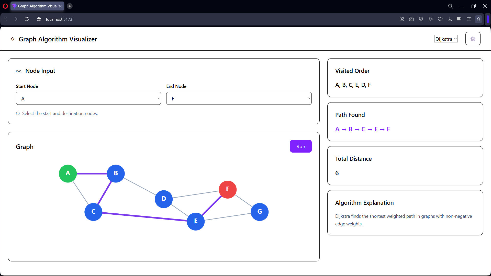

# Graph Algorithm Visualizer

A responsive web application that works as a visualizer for graph traversal and pathfinding, allowing users to select among four different algorithms and see how they find a path between two nodes. I built this project to become more familiar with breaking down and developing a complete project, using AI as a development and learning tool, and developing a better understanding of algorithms and their practical applications.
## Live demo(maybe)

## Screenshots




## Features

- Compare four different graph traversal and pathfinding algorithms.
- Select the start and end nodes for each algorithm.
- Visualize the path found by the selected algorithm.
- View the order in which nodes were visited.
- View the resulting path distance or cost.
- Read a short explanation of how the selected algorithm works.

## How It Works

User selects an algorithm and chooses a start and end node. These selections are stored in React state. When the user runs the algorithm, the selected algorithm receives the graph data and chosen nodes and searches for a path between them. 

During search, the algorithm records the order in which nodes are visited and reconstructs the resulting path. The result is then stored in React state, causing the application to re-render and display the path and traversal information.


The basic data flow is:

User selects an algorithm and start/end nodes
→ selections are stored in React state
→ user runs the algorithm
→ selected algorithm receives the graph and selected nodes
→ algorithm returns the result
→ result is stored in React state
→ graph and results panel re-render with the result

## Tech Stack 

- JavaScript — Handles the application logic.
- React — Used to build the UI and manage data flow.
- Tailwind CSS — Used to style the interface and create a responsive design.
- Vite — Used as the development server and build tool for the React application.


## Running Locally

To run this project locally:

1. Clone the repository:
   ```bash
   git clone <your-repository-url>
   ```

2. Navigate to the project directory:
   ```bash
   cd search-algorithm
   ```

3. Install the project dependencies:
   ```bash
   npm install
   ```

4. Start the development server:
   ```bash
   npm run dev
   ```

5. Open the local URL provided by Vite in your browser.

## What i Learned 

── Breaking a larger project into smaller pieces
── React components
── React state and data flow
── Tailwind styling
── Building a complete application

── Working with graph data
── Using BFS, DFS, Dijkstra and A*
── Connecting algorithm output to a visual UI
── Seeing how different algorithms approach the same graph

